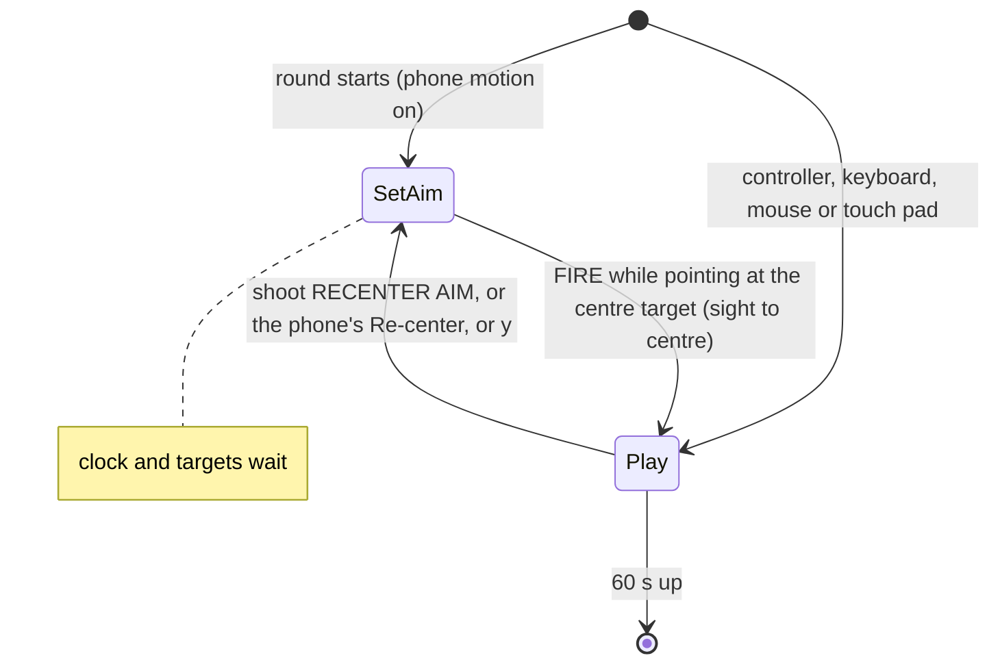

# Motion Lab: design brief

> Turn your phone into a motion controller and put it through seven quick stations: tilt a marble through a maze, swing for the fences, slash fruit, shake a maraca on the beat, steer a kart and use the phone as a light gun, with a live sensor bench to see exactly what the phone is sending.

*Status: shipped · Version: 1.10.0*

## Kickoff
| Topic | Answer |
|---|---|
| Concept / genre | A hub of motion-control mini-games (stations) for testing phone motion controls |
| 2D or 3D | 2D canvas |
| Art style | Bright "test lab": dark blueprint grid, chunky rounded shapes, bold flat colours, thick outlines |
| Players | Solo. Party scaffold with one active phone; a second phone may join and take over (to compare phones, e.g. Android vs iPhone) |
| Feel | Snappy and juicy: every motion gets instant, big feedback |
| Camera / view | Fixed single screen per station; Home Run cuts to a field view for the ball flight |
| Session and structure | Station hub; 60–90 s rounds ending in score, bronze/silver/gold medal and personal best; one-press retry |
| Like which game? | Wii Sports, WarioWare: Smooth Moves, Fruit Ninja, Rhythm Heaven, toy kart racers, light-gun shooting galleries |
| Audience and difficulty | The owner, testing; forgiving early, ramps within each round *(assumed)* |
| Assets | Fully procedural *(assumed)* |
| Sound and music | Generated SFX for every action; generated loops per station; the rhythm station has its own song *(assumed)* |
| Progression | Medals and best score per station, shown on the hub *(assumed)* |
| Phones | Mostly Android; iOS supported through the join page's "Allow motion controls" button |
| Fallback | Every station also plays with controller, keyboard, mouse and touch |

## Fun targets
- **Primary:** Sensation. Your real arm swing becomes a bat crack, a fruit split, a maraca hit; big particles, hit-stop, phone buzz.
- **Secondary:** Challenge. Short timed rounds with medals and bests to beat; the Sensor Bench feeds curiosity (what is my phone really sending?).

## Core loop
- **Moment-to-moment:** read a cue (pitch, arrow, beat, corner) → make a motion → immediate judgement and juice.
- **Round:** 60–90 s station, ramping speed and density, ending in a results tally with medal.
- **Meta:** earn gold on every station; compare phone vs controller feel; tune sensitivity in Settings and the Bench.

## Motion pipeline
- **Join page (kit `shell.js`)**: asks for permission (iOS needs a tap on that page), holds a wake lock, and every 16 ms posts every sensor event since the last post: `{ age, a, g, w, o }` (linear acceleration, acceleration with gravity, rotation rate in deg/s, orientation). The older `r` peak reading is still sent for other games. Without https it answers `insecure`, and the phone says so and becomes a touch pad.
- **Phone (`createPhoneMotion()` in `controller.html`)**: uses every sample (60–200/s), from the join page or from its own listeners (Android only sends events to the focused frame), whichever is fresh. It turns axes with the screen (`screen.orientation.angle`), learns gyro drift while the phone lies still and subtracts it, and gives tilt as the direction of "up". Gyro aiming does not use the screen's rotation: it reads the turning rates in the phone's own axes (`rotationRate.alpha/beta/gamma` are the rates about x/y/z, in that order) and splits them by gravity into left/right (around the real vertical) and up/down (around the level axis across the aim), so it works with rotation lock on and in either sideways grip. It waits for the first orientation reading before moving the aim. Swings are detected per sample: flicks and shakes are timed at their peak, bat swings at the push-to-stop turn or, for a mostly turning swing, the gyro's peak. Stations that count turning (`swing.gyro`) add the gyro to the strength. Each swing is sent with `pt`, its moment on the phone's clock. Every number comes live from `controller.public.cfg` (TUNING.motion). A swing meter shows strength against the threshold; a chip says when readings stall.
- **TV (`motion.js`)**: clock sync. Pings every second (4 quick ones on connect); the fastest of the last 8 round trips sets the phone→TV clock difference, and swing times map through it (the RTT/2 estimate is only a fallback). Calibrated `tilt.x/y`, gyro `dx/dy`, pointing, fire and a swing queue, with the same interface fed by stick / arrows / mouse / touch. Re-centering waits (≤ 1.5 s) for the phone to be still. The level pose and the Derby and Rhythm timing offsets are saved per player name (`save.data.profiles`).
- **Safety first** (`safety.js`): before the first round with a phone (and again for any other phone that takes over), the TV shows **Before you move** (give yourself room; hold on tight; smooth beats wild) and the phone shows the same card with **I'm ready** (`public.mode 'safety'`, it sends `{ safe: true }`). The round, its countdown and any re-centre wait for it; A / Start now on the TV skips it after `TUNING.safetyMin` (2.5 s). Each phone reads it once.
- **Stick vs phone**: the stick takes over only while the phone is held level (or there's none), so a stray stick can't fight an active phone.

## The 8 formal elements
| Element | This game |
|---|---|
| Players | One (one active phone) |
| Objectives | Beat each station's score for bronze/silver/gold |
| Procedures | Tilt, swing in a direction, shake, turn the phone to aim, press the phone's on-screen button |
| Rules | Timed rounds; misses break combos; holes respawn the marble; grass slows the kart; shooting a bot costs points |
| Resources | Time, combo, swings (Derby has 10 pitches) |
| Conflict | Faster pitches, denser fruit and notes, coins off the racing line, trickier mazes, quicker sliding targets |
| Boundaries | One screen per station; the phone is the controller |
| Outcome | Score, medal, personal best |

## Stations (v1)
| Station | Motion | Phone button | Fallback |
|---|---|---|---|
| Sensor Bench | everything, live graphs, swing log, latency, recalibrate | Re-center | stick / keys / mouse show their values too |
| Marble Maze | tilt | hold BRAKE | stick / arrows; mouse/touch drag direction from the ball |
| Home Run Derby | swing (timing + strength) | (none) | `a` / click / tap = swing |
| Fruit Slash | directional flick (← → ↑ ↓) | (none) | d-pad / arrows / stick flick; mouse/touch swipe |
| Maraca Rhythm | shake on the beat; big notes want a hard shake | (none) | `a` / click / tap on the beat |
| Kart Dash | steering wheel: phone held up and turned (gravity across its face) | hold BRAKE | stick / arrows steer, `a` brakes; mouse/touch hold where to steer |
| Blaster Range | light gun: phone held sideways in both hands, turned to aim (gyro, like a mouse) | FIRE (the whole screen, either thumb) | stick moves the sight + `a`; mouse/touch aim and click/tap |

## Controls
| Input | Action |
|---|---|
| Left stick / d-pad (`x`, `y`) | Hub: choose station. Stations: tilt stand-in, slash direction, sight |
| `a` | Choose; swing / shake / fire stand-in |
| `b` | Hub: back to title. Bench: back to stations. Otherwise unused in play |
| `y` | Re-center tilt (also the phone's Re-center button); Blaster Range: set the aim again |
| `menu` (Start / Esc / on-screen button) | Pause |

- **Inputs:** gamepad, keyboard, mouse, touch (all stations have fallbacks).
- **Phone as menu remote:** outside rounds the phone shows a D-pad, OK and Back (and the station list on the hub), sent as `{ nav }` / `{ pick }` and merged into the menus' input; during rounds it shows Pause (Back on the bench) next to Re-center.
- Pause menu: Resume, Restart, Settings, Stations, Quit to title. "Stations" is added before Quit to title so a round can be left without dropping the phone connection; Quit to title keeps the party open too.

## Inspirations
| Game | Borrow | Change / avoid |
|---|---|---|
| Wii Sports (Baseball) | Swing timing + strength, crack of the bat, distance readout | No full 3D; quick 10-pitch rounds |
| Fruit Ninja | Fruit arcs, juicy splits, combos | Slash direction is a motion flick, not a finger trail |
| Toy kart racers | Top-down track, ghost of your best lap, coins on choice lines | Auto gas and a single BRAKE, so a phone held as a wheel is enough |
| Rhythm Heaven / WarioWare Smooth Moves | Short motion verbs, clear cue → action | Phone motion with latency compensation |

| Light-gun shooting galleries (and phone light-gun games) | Pop-up targets, a gun on screen with a tracer to the sight, set your aim by shooting, re-center by shooting off to the side | Toy test-range look; gyro aim with no camera; don't-shoot bots instead of reloading |

**Twist:** it's a test lab: the Bench shows the raw signal and every station tells you how your motion was read.

## Art direction
- **Style:** glossy toy lab (see [STYLE.md](STYLE.md))
- **Palette:** `#0f1630` background with `#1a2550` grid, `#ff8a3d` orange (hero/accent), `#2ad1c9` teal, `#ff5c8a` pink, `#b6f04a` lime, `#ffd23f` gold, `#eef2ff` text
- **Font:** Lilita One (display) and Rubik, bundled in `assets/fonts/` for the game and the art
- **Rendering:** 2D canvas, procedural
- **Cover idea:** a chunky phone tilted mid-swing with motion arcs, around it a kart, a fruit split and a baseball; "MOTION LAB" big (Blaster Range isn't on the cover yet)
- **Hero idea:** blueprint grid, the phone on the right with sensor waves and the station icons orbiting it

## Audio
- **SFX:** tone/noise blips per action: bat crack, slice, maraca shaker noise, blaster shot, marble roll/fall, medal fanfare.
- **Music:** a light generated loop on the hub; Rhythm has a beat-synced song scheduled on the audio clock.

## Scope
**v1 must-haves**
- Motion pipeline with calibration, swing detection on the phone, latency ping, phone touch fallback
- Hub with medals; seven stations; results screen with medal and best; save
- Custom phone screen per station (status, big button where the station uses one)

**Stretch**
- Daily gauntlet, Fishing, Simon Poses, Sky Glider

## Definition of done
**Play**
- [x] Each station teaches its verb with one on-screen prompt; clear goal; score + medal + best; ramps within the round; retry in one press
- [x] Every station works with phone, controller, keyboard, mouse and touch

**Feel**
- [x] Feedback for every motion (visual + audio + phone buzz); hit-stop and shake on hits (off with reduced shake)

**Audio**
- [x] SFX and music through `audio.js`, following the Settings sliders; unlocks on first input

**Screens and flow**
- [x] Title, pause, results, settings on `menu.js`/`settings.js`; auto-pause; no exit of its own
- [x] Saves under `motion-lab-save-v1`; cursor hidden only during gameplay; `state.screen` + `window.__game`

**Accessibility**
- [x] Arrows/shapes not just colours; no mashing required; reduced shake; text scale; prompts from `input.label`

**Scaling and inputs**
- [x] `fitCanvas`; manifest `tags` + `inputs`

**Under the hood**
- [x] `TUNING`, clamped `dt`, `?debug` overlay, runtime files unedited, `npm run check` green

## Open questions / assumptions
- Phones are held in portrait, except Kart Dash (sideways, as a wheel) and Blaster Range (sideways, as a light gun). Swing direction is read in the phone's own axes; "Invert swipes" in Settings flips it if a phone reports the other way.
- Motion only works when the phone joins over HTTPS (the published build). Over local `npm run dev` the phone uses its touch pad.
- The kit's lobby only starts on A, so the lobby also draws Start / Back buttons for mouse and touch.
- Known gaps: landscape remapping (swipes and tilt) is tested with simulated sensors only, so check it on a real phone in the Bench (Screen turn row); the 1.9.1 gyro aiming fix is tested against the browser spec's axes, not yet on a real phone; no personal full-swing scale yet; the library screenshot shows the connect screen, not a station.

## Blaster Range: aiming without knowing where the TV is
A phone can't tell where the TV is (1.8.0 below), so Blaster Range doesn't try to make the sight land where the phone physically points. The gyro moves the sight like a mouse, and the player's eyes close the loop. What keeps that working over a whole round:

- **Set the aim by shooting.** Each round starts with a centre target ("Set your aim"); pulling the trigger while pointing at it puts the sight in the middle. The clock waits.
- **Edges soak up drift.** The sight stops at the screen edges and any further turn is dropped, like a mouse at the edge of its pad, so slow drift is lost there.
- **Re-center without looking down.** RECENTER AIM sits on the front counter: aim down and shoot it, then shoot the centre target again. The phone's Re-center button and `y` do the same.
- **Shots are judged when the trigger was pulled.** The phone counts trigger presses (`fc`) and stamps the last one (`ft`) on its clock; the TV maps that through the clock sync to `motion.fireAt` and checks targets where they were then (up to `rewindMax`, 0.3 s), so network lag doesn't cost hits. The counter also catches taps shorter than a network update, and a second thumb landing while the first rests on the button.
- **A light gun feel.** A toy blaster in the corner tracks the sight with a tracer on every shot; the sight is a little sticky over targets (aim assist slows it, it never pulls); the phone's whole screen is the trigger (`public.layout = 'trigger'`).

Medals (5000 / 12500 / 16000) come from simulated players with lag and drift: a good one averages about 17,000 (gold), a casual one about 12,000 (bronze, sometimes silver), a newcomer about 3,800.

## Changelog
- 1.10.0: **Before you move**: a safety screen on the TV and a card on the phone before the first round with each phone (room, a firm grip, a controlled motion). The round waits for I'm ready, or the TV skips it after a moment. Tests: `tests/safety.test.js`.
- 1.9.1: **Gyro aiming fixed** (first real-phone test of Blaster Range: the sight moved in no consistent direction and wandered off). Two bugs in the phone engine: the gyro's three rates were read in the wrong order (`rotationRate.alpha/beta/gamma` are about x/y/z, not z/x/y as the orientation angles of the same names suggest), and up/down was taken from the screen's rotation, which stays 0 with rotation lock on. Turning the phone left or right never moved the sight left or right, in any grip. Aim now goes by gravity in the phone's own axes (see Motion pipeline), and rolling the phone no longer moves it. Since the same axis order was in the 1.8.0 code, the earlier "gyro aiming feels strange" playtests probably judged this bug. The phone engine has tests now (`tests/phone.test.js` runs `createPhoneMotion` out of `controller.html` against a stand-in browser). Research on where to take aiming next (an anchored pointer from the phone's fused orientation, less delay, no slowdown over targets) is in `docs/research/phone-light-gun-aiming.md`; none of that is built yet.
- 1.9.0: **Blaster Range**, a light-gun station: hold the phone sideways in both hands, turn it to aim, tap anywhere on its screen to fire. 60 s of pop-up targets on three rails (sliding ones speed up, gold ones score triple, don't-shoot bots cost 150 and the combo); combos raise points up to ×2, bullseyes +50. Aim is gyro-as-mouse with set-your-aim by shooting a centre target, edge clamping, and RECENTER AIM on the counter (see "Blaster Range: aiming…" above). The TV side has gyro deltas again (`motion.gyro`, `motion.gyroAhead`); the phone counts and time-stamps trigger presses (`fc`, `ft` → `motion.fireAt`) and has a full-screen trigger layout. The hub is a 5 × 2 grid. Tests: `npm test` (station and motion behaviour, no dependencies).
- 1.8.1: Build kit v6. Inside the launcher the pause menu ends with **Quit to library** (added by `menu.js`), so players can always find their way back to their games.
- 1.8.0: **Kart Dash replaces Duck Shoot.** Pointing at the screen can't be made to feel right with a phone: a Wii pointer works because the remote's camera sees the sensor bar, but a phone only knows how it turns, not where the TV is or where your arm is. So "where it points" is always relative to the last re-center, the heading drifts a few degrees a minute, position from the accelerometer drifts away within a second, and the network adds 50–150 ms. Gyro aiming (Splatoon-style) is the best that's possible, and casual players find it strange (two playtests agreed). Steering is the opposite: `motion.wheel` is gravity's angle across the phone's face, absolute, drift-free and unbothered by lag. Kart Dash is a 75 s top-down time trial: phone sideways as a wheel, automatic gas, hold BRAKE for tight corners, 100 per lap and 10 per coin, and your best lap drives beside you as a ghost (best lap saved). The centre is taken during the countdown. Simulated drivers: a good one gets gold (5 laps, ~1100), a laggy, wobbly casual one bronze (3 laps, ~610). The pointing and gyro-cursor code left the TV side; the phone engine still sends gyro totals for other games.
- 1.7.1: Second playtest. Duck Shoot needs far less turning: about 55 px per degree across and 65 up/down (TUNING.motion.pointPxX/Y; before it was 30, so about 21° to an edge), so moving your arm is enough. Marble Maze and Duck Shoot take their centre from how you hold the phone during the round's countdown (now 2 s, "Hold the phone comfortably" / "Point at the middle"). Before, Maze used a level pose saved from another station (e.g. an upright Duck Shoot re-center), so you had to tilt a long way to roll down.
- 1.7.0: From the first phone playtest. **Duck Shoot** now points like a remote: the sight goes where the phone's back (held upright) or top edge (held flat) points in the room, worked out from the full orientation, so it no longer goes strange when the phone stands upright (the raw angles flip there). The gyro moves the sight between readings, and the pointing pulls it back into line (TUNING.duck.gyroPull), so it can't drift away from the phone. **Fruit Slash** reads flicks in the room's directions: up is toward the ceiling however you hold the phone (before, a flat phone read forward/back as up/down). **Marble Maze** has a steering assist: sideways speed bleeds off toward the tilt and reversing brakes harder, so the marble stops circling its target (in a lagged-player simulation, a casual player reached a target in 2.5 s instead of 5.5 s; skilled players unchanged). Tilt smoothing is quicker (filterMin 1.6). Gyro drift is only learned when the phone truly rests, slowly, and is capped at 1.5°/s, so a slow steady aim isn't "corrected" away.
- 1.6.0: Motion best-practice pass. Gestures are detected from every sensor event with exact timestamps (not one peak per 33 ms), swing times sync to the TV through a clock check instead of half the ping, landscape no longer rotates swipes, gyro drift is learned and removed, Derby and Rhythm count wrist turning, re-center waits for a still phone, calibration and timing are saved per player, the stick no longer overrides a phone being tilted, the phone shows a swing meter and says when motion stalls or needs https, and the Bench shows sensor rate, clock sync, drift and screen turn.
- 1.5.0: Duck Shoot aims with the gyro like a mouse (as Steam Input / JoyShockMapper do): the phone's turn rate moves the sight, in player space (turning around the real vertical), with tightening for tremor and soft tiered smoothing for small moves only; the phone sends running totals and the TV plays bursts out over ~30 ms, so the sight glides. Home Run Derby times a swing at the push-to-stop turn (fastest bat speed) instead of the push's peak, and slowly learns your steady timing bias (kept between rounds).
- 1.4.0: Art pass (glossy toy lab): lit blueprint backdrop with vignette and grain, moulded panels, glossy three-tone shapes with ink edges, bundled fonts; baked scenery for the maze board, ballpark (sky, crowd, mown grass), cutting mat, stage lights and the duck range; cover and banner drawn with the game's own code.
- 1.3.0: Title, pause and results menus appear on the phone as tappable buttons, and any connected phone can work the menus. Home Run Derby is seen from behind the catcher with a right-handed batter beside the plate: the ball grows in true perspective, the bat is level over the plate at the instant the swing counts, and a timing meter shows early/late after each swing. Phone tilt and pointing go through an adaptive (One Euro) filter so Duck Shoot aiming is steady without feeling slow.
- 1.2.1: Touching the handheld's screen (which can arrive as a mouse click) no longer locks the Duck Shoot sight to that spot: the mouse or a finger aims only while it moves or presses, then the phone takes over again. The Sensor Bench shows what the screen/mouse is reporting.
- 1.2.0: The phone runs the menus too: a station list on the hub, a D-pad with OK and Back on every menu (title, pause, results, settings), and Pause and Back buttons during play, so nothing needs pressing on the handheld.
- 1.1.0: Re-center (and any phone button) no longer stops motion: on Android only the focused frame gets sensor events, so the phone screen now reads them itself too. Duck Shoot aims by pointing the phone like a remote (tilt until the phone reports its turn), and tilt no longer couples its axes. Swings are timed at their peak, not their start; Home Run Derby has a wider window where early pulls left and late goes right; Maraca Rhythm has wider windows, a lower shake threshold and keeps learning your delay; Fruit Slash reads direction from the whole push of a flick and ignores the stop that follows.
- 1.0.0: First version: Sensor Bench, Marble Maze, Home Run Derby, Fruit Slash, Maraca Rhythm, Duck Shoot.
